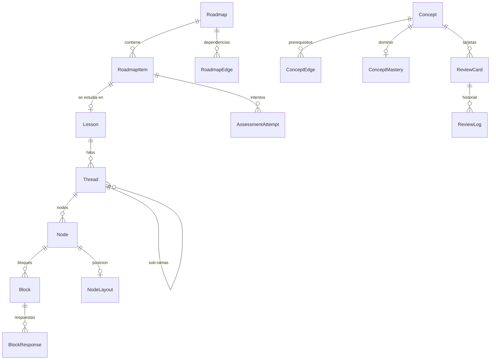

# Modelo de datos

Este documento describe el modelo de datos de LearnAI. Es independiente de la
plataforma y de la base de datos: los tipos están escritos en TypeScript como
notación y se traducen directamente a tablas relacionales (por ejemplo, SQLite).

## Decisiones generales

- **Local y usuario único.** No hay `userId` en las entidades. Cuando exista
  sincronización o un marketplace, el contenido exportable sumará un campo de
  autor.
- **IDs globalmente únicos.** Todas las entidades usan UUID v7 o ULID, nunca
  autoincrementales, para poder importar contenido ajeno sin colisiones.
- **Contenido separado del progreso.** El contenido (roadmaps, lecciones, hilos,
  nodos, bloques, conceptos) es exportable y compartible. El progreso
  (respuestas, dominio de conceptos, repaso, layout) es personal y nunca se
  exporta.
- **El contenido se genera una vez y se persiste.** La IA genera planes,
  lecciones y preguntas que quedan guardados; volver a una lección muestra
  siempre lo mismo. La interacción (corregir respuestas, responder dudas) es en
  vivo.



---

## Contenido

### Roadmap

El mapa de estudio, al estilo de roadmap.sh.

```ts
type Roadmap = {
  id: string
  title: string                 // "Cómo funciona un motor de base de datos"
  goal: string                  // qué quiere lograr el usuario
  diagnosis: Diagnosis
  settings: StudySettings
  createdAt: Date
}

type Diagnosis = {
  answers: { question: string; answer: string }[]
  estimatedLevel: 'none' | 'basic' | 'intermediate' | 'advanced'
  summary: string               // lo que la IA infirió; se usa como contexto
}

type StudySettings = {
  depth: 1 | 2 | 3 | 4 | 5      // visión general → implementarlo desde cero
  aiHelp: 'guided' | 'hints' | 'socratic'
  gating: boolean               // evaluaciones bloqueantes activadas
}
```

### RoadmapItem y RoadmapEdge

Los elementos del roadmap. `parentId` agrupa (sección → temas) y `RoadmapEdge`
expresa prerequisitos ("B requiere A"). Son dos relaciones distintas: el
bloqueo por evaluaciones se calcula a partir de los edges.

```ts
type RoadmapItem = {
  id: string
  roadmapId: string
  parentId: string | null
  kind: 'section' | 'topic' | 'assessment'
  title: string
  description: string
  order: number
}

type RoadmapEdge = {
  roadmapId: string
  fromItemId: string            // prerequisito
  toItemId: string
}
```

El estado de cada item (`locked`, `available`, `in_progress`, `completed`) no
se guarda en el contenido: se deriva del progreso (lecciones completadas,
`AssessmentAttempt` aprobados y los edges).

### Lesson

Una lección. Puede pertenecer a un item del roadmap o ser estudio libre.

```ts
type Lesson = {
  id: string
  roadmapItemId: string | null  // null = estudio libre
  title: string
  settings: StudySettings       // hereda del roadmap; se puede sobrescribir
  rootThreadId: string
  createdAt: Date
}
```

### Thread

La lección es un árbol de hilos. Cada hilo es una secuencia lineal de nodos. El
hilo raíz es el **tronco**; cualquier otro hilo es una **rama** que nace de un
bloque concreto de un nodo. Las ramas pueden anidarse sin límite.

```ts
type Thread = {
  id: string
  lessonId: string
  parentThreadId: string | null // null = tronco
  anchor: Anchor | null         // desde dónde nace la rama
  summary: string | null        // se genera al cerrar la rama
  status: 'open' | 'closed'
}

type Anchor = {
  nodeId: string
  blockId: string
  quote?: string                // fragmento seleccionado, si fue un párrafo
}
```

### Node

Un mensaje dentro de un hilo, del agente o del usuario.

```ts
type Node = {
  id: string
  threadId: string
  order: number                 // posición dentro del hilo
  role: 'agent' | 'user'
  createdAt: Date
  generation?: GenerationMeta   // solo en nodos del agente
}

type GenerationMeta = {
  model: string
  promptVersion: string
  tokensIn: number
  tokensOut: number
}
```

### Block

El contenido de un nodo es una lista ordenada de bloques tipados. La IA los
genera como salida estructurada validada contra un esquema. Los mensajes del
usuario también son bloques (`user_message`), así todos los nodos tienen la
misma forma.

```ts
type Block = {
  id: string
  nodeId: string
  order: number
  conceptIds: string[]          // conceptos que introduce o usa
} & BlockContent

type BlockContent =
  | { type: 'explanation'; markdown: string }
  | { type: 'code'; language: string; source: string; runnable: boolean }
  | { type: 'diagram'; format: 'mermaid'; source: string }
  | { type: 'reference'; title: string; url: string; excerpt?: string }
  | { type: 'prediction'; question: string }
  | { type: 'check'; kind: 'free_text' | 'multiple_choice' | 'code' | 'find_bug';
      question: string; options?: string[]; rubric: string }
  | { type: 'user_message'; markdown: string }
```

- `prediction` y `check` frenan la lección: el siguiente bloque no se muestra
  hasta que el usuario responde.
- `prediction` no se califica; `check` sí, usando la `rubric` que la IA genera
  junto con la pregunta, para que la corrección sea consistente.

### Evaluaciones

Una evaluación es una `Lesson` asociada a un `RoadmapItem` de tipo
`assessment`, compuesta principalmente por bloques `check`. No requiere una
entidad de contenido propia.

### Concept y ConceptEdge

Un concepto es la unidad mínima de conocimiento que el sistema puede afirmar que
el usuario sabe o no sabe ("B-tree", "write amplification"). Las lecciones
enseñan conceptos; los `check` los evalúan; el repaso trabaja sobre ellos.

```ts
type Concept = {
  id: string
  slug: string                  // "b-tree"
  name: string
  description: string
}

type ConceptEdge = {
  fromConceptId: string         // prerequisito
  toConceptId: string
}
```

Los extrae la IA al generar contenido: cada nodo declara qué conceptos introduce
o usa, y cada `check` qué conceptos evalúa. Al generar, se le pasan a la IA los
conceptos existentes para que reutilice ids en lugar de crear duplicados.

---

## Progreso

### BlockResponse

```ts
type BlockResponse = {
  id: string
  blockId: string
  answer: string
  grade: 'correct' | 'partial' | 'incorrect' | null  // null en prediction
  feedback: string | null
  createdAt: Date
}
```

### AssessmentAttempt

```ts
type AssessmentAttempt = {
  id: string
  roadmapItemId: string
  lessonId: string
  score: number                 // 0..1
  passed: boolean
  weakConceptIds: string[]      // qué repasar si no aprobó
  createdAt: Date
}
```

### ConceptMastery

Cuánto domina el usuario cada concepto. Se recalcula a partir de señales:

| Señal | Efecto |
|---|---|
| Responder bien un `check` | Sube |
| Responder mal un `check` | Baja |
| Abrir una rama desde un bloque que introduce el concepto | Baja levemente |
| Aprobar una evaluación que lo incluye | Sube fuerte |
| Acertar en el repaso espaciado | Sube |
| Pasar tiempo sin verlo | Decae gradualmente |

```ts
type ConceptMastery = {
  conceptId: string
  level: number                 // 0..1
  evidence: number              // cuántas señales lo respaldan
  lastSeenAt: Date
}
```

Si un concepto falla repetidamente, se revisan sus prerequisitos
(`ConceptEdge`): el problema real puede estar un nivel más abajo.

### ReviewCard y ReviewLog

Repaso espaciado con FSRS (el algoritmo que usa Anki).

```ts
type ReviewCard = {
  id: string
  conceptId: string
  question: string
  answer: string
  due: Date
  stability: number
  difficulty: number
  reps: number
  lapses: number
}

type ReviewLog = {
  cardId: string
  rating: 'again' | 'hard' | 'good' | 'easy'
  reviewedAt: Date
}
```

### NodeLayout

Estado de la vista del canvas. Si un nodo no tiene fila, se usa el layout
automático calculado a partir del árbol (por ejemplo, con elkjs o dagre). El
usuario puede mover nodos libremente pero no desconectarlos: la estructura la
definen los hilos, no las posiciones. La acción "ordenar" borra las filas de la
lección.

```ts
type NodeLayout = {
  nodeId: string
  x: number
  y: number
  collapsed: boolean
}
```

---

## Reglas de comportamiento

### Contexto de la IA en una rama

Al generar un nodo en un hilo, el contexto se arma con:

1. El camino de hilos ancestros, cada uno truncado en su ancla.
2. Los nodos del hilo actual.
3. Los `summary` de las ramas hijas ya cerradas.

No entran las ramas hermanas ni lo que vino después del ancla en el hilo padre.

### Editar o regenerar un nodo

En la primera versión los nodos no se pueden editar ni regenerar. Si se agrega,
funciona como en Cursor: la conversación vuelve a ese nodo y todo lo posterior
se pierde. Al editar o regenerar el nodo N del hilo T se eliminan:

1. Los nodos de T posteriores a N.
2. Los hilos anclados a esos nodos y al propio N, recursivamente con sus
   sub-hilos.

Las ramas que nacen antes de N se mantienen. Las `BlockResponse` de los bloques
eliminados se borran y el `ConceptMastery` afectado se recalcula, para no
inflar el dominio con respuestas a contenido que ya no existe.

### Exportar e importar

Exportar un roadmap incluye solo las entidades de contenido. Importar asigna
las entidades tal cual (los ids son globalmente únicos) y fusiona los conceptos
con los existentes.

---

## Preguntas abiertas

- **Duplicados de conceptos.** La IA puede generar "B-tree", "árbol B" y
  "B+ tree" en lecciones distintas: los dos primeros son el mismo concepto, el
  tercero no. Para la primera versión alcanza con pasarle a la IA los conceptos
  existentes. Más adelante: embeddings con búsqueda por similitud o un modelo
  clasificador dedicado.
- **Conceptos globales.** Para el marketplace, los conceptos necesitan una
  identidad compartida entre usuarios para fusionarse al importar.
